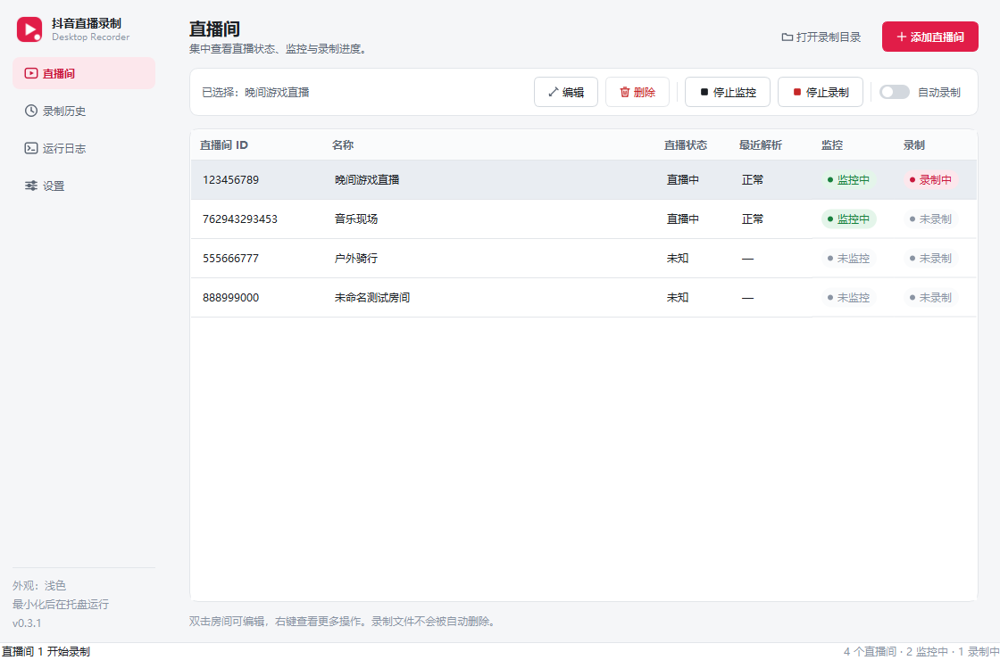
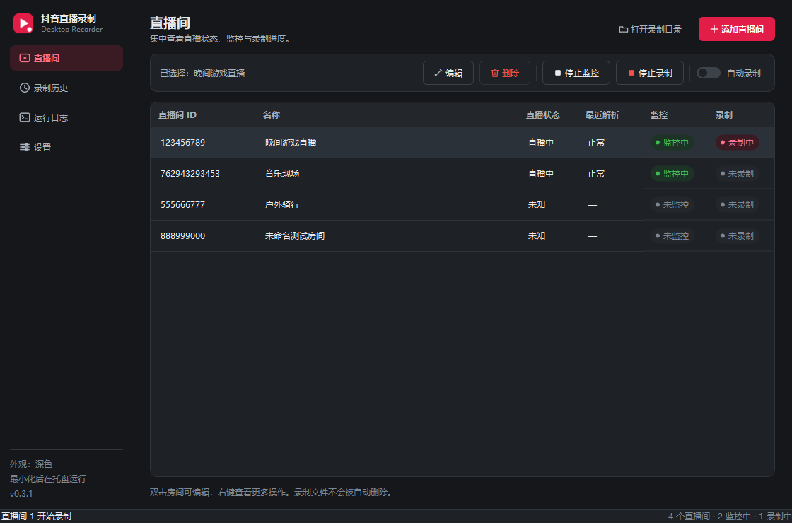
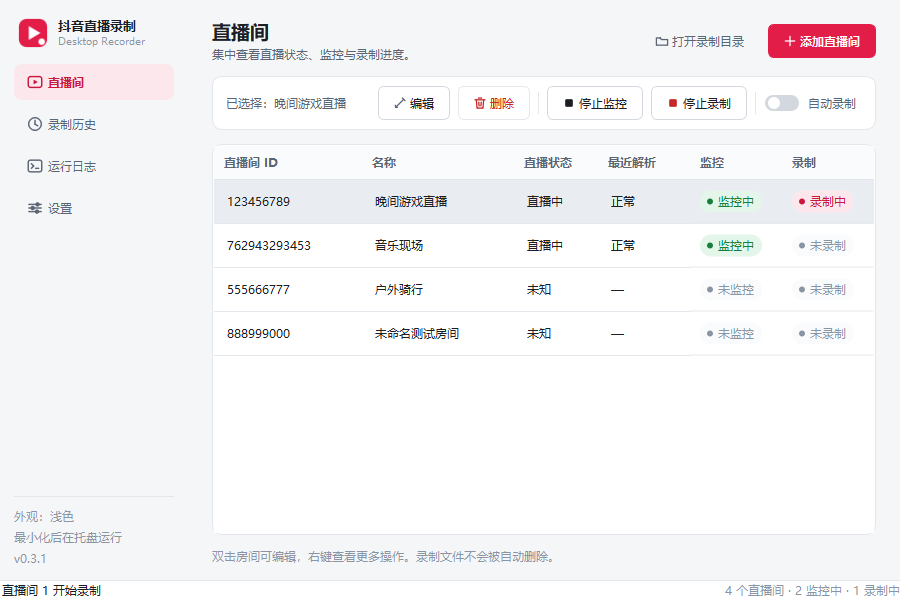
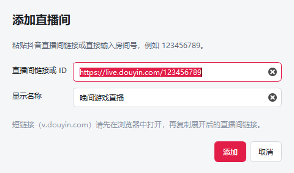
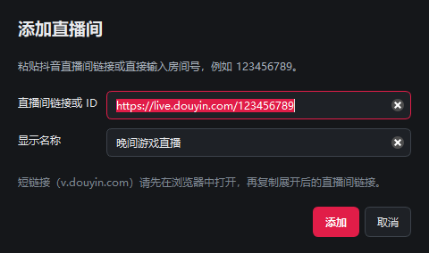
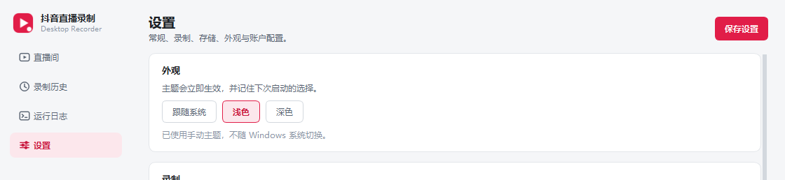
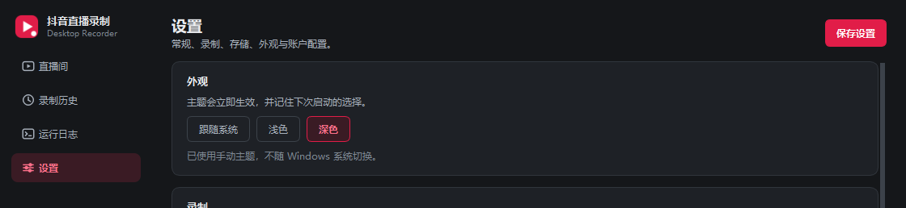
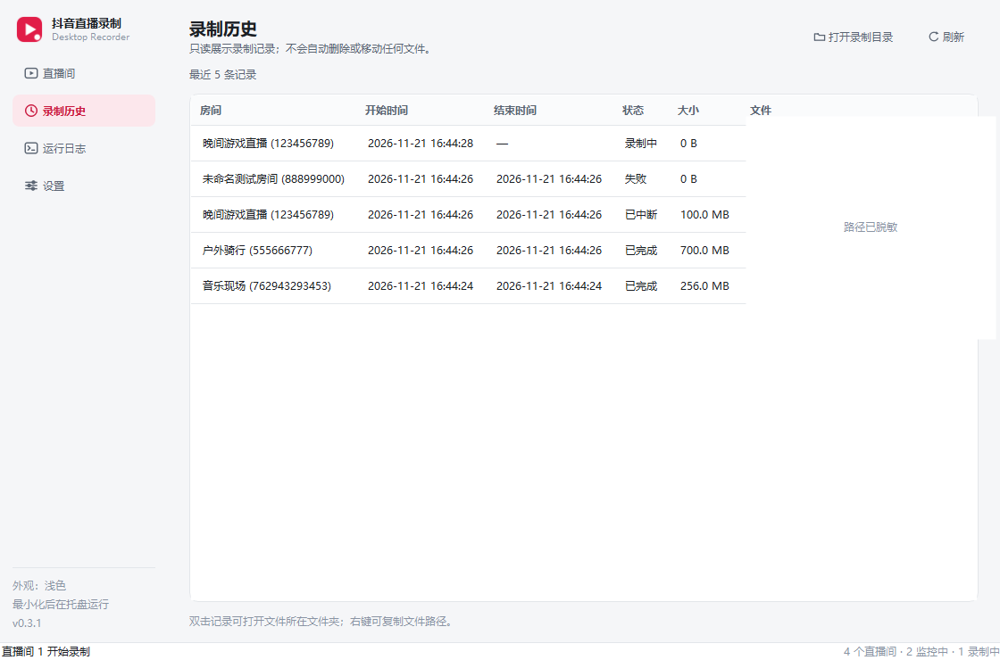
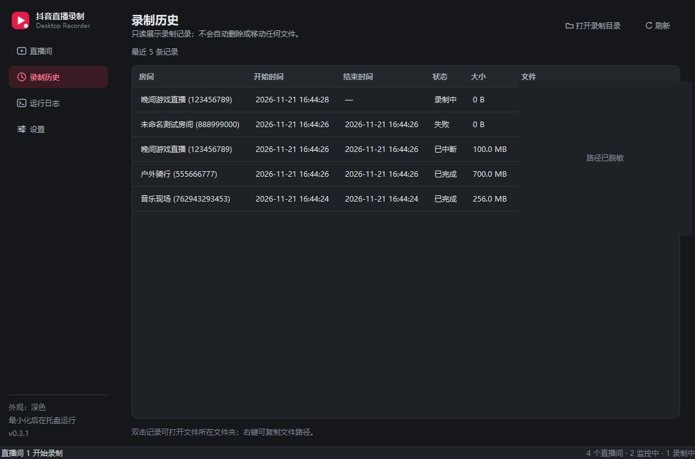
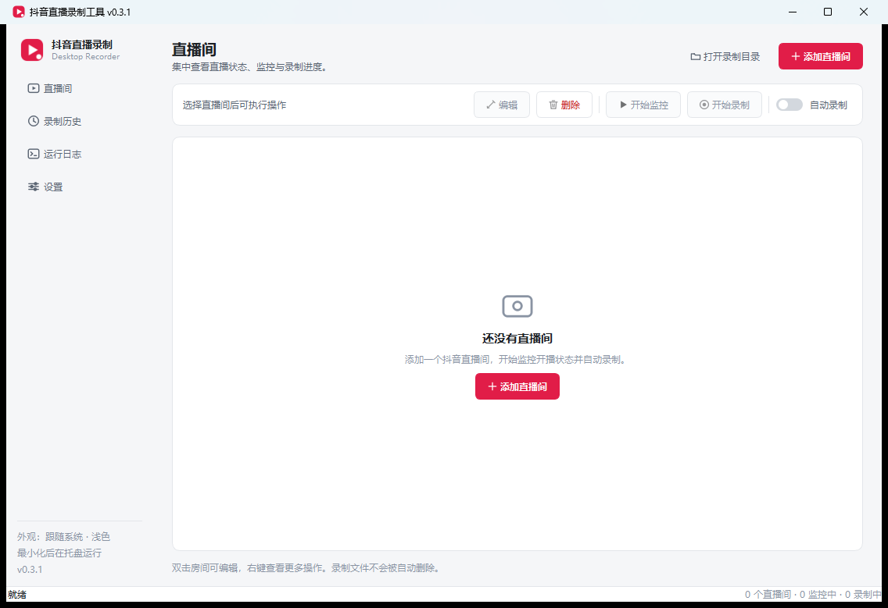

# GUI 候选版验收收尾报告（0.3.1 Candidate）

- 日期：2026-11-21
- 性质：L2 受控验证与最小修复；未重新开发 GUI，未修改正式 v0.3.1
- 结论：托盘初始化异常路径发现实际缺陷，已最小修复并生成**候选版 2**；视觉资料已选图与脱敏；真实直播验收仍等待授权房间开播。

---

## 1. 托盘异常专项验证

### 1.1 模拟方法

- 环境：`QT_QPA_PLATFORM=offscreen`，独立临时数据目录，独立 Python 进程。
- 注入方式：将 `MainWindow._setup_tray` 使用的 `TrayController` 替换为构造即抛 `RuntimeError` 的类；不修改候选包。
- 同时统计 `RecordingService.shutdown` 调用次数，检查窗口可见性与进程退出码。

### 1.2 修复前（候选版 1 代码）

| 检查项 | 结果 |
| --- | --- |
| 启动结果 | `Application()` 抛异常，启动失败，退出码 4 |
| 错误提示 | “程序启动失败，无法打开数据目录或数据库：simulated tray init failure…”——**归因错误**（实际是托盘异常） |
| 录制服务 shutdown | 0 次（未错误触发） |
| 主窗口 | 未完成构造，无可恢复窗口（不存在“隐藏后无法恢复”） |
| 进程退出 | 提示打印后以 `-1073740791`（NTSTATUS `0xC0000409`）异常终止 |

结论：**实际缺陷**——可选托盘失败会导致整个应用无法启动，错误提示误导，且进程异常终止。

### 1.3 修复内容

- 提交：`f168880` `fix(gui): 托盘初始化异常时安全降级`（11 行新增、2 行删除）
- 位置：[main_window.py](../src/dlrecorder/presentation/main_window.py#L218-L238)
- 行为：捕获托盘构造/初始化异常 → 记录堆栈 → 恢复 `quitOnLastWindowClosed(True)` → 侧边栏提示“系统托盘不可用” → 继续正常启动；不触碰录制服务。

### 1.4 修复后复测

| 检查项 | 结果 |
| --- | --- |
| 应用构造 | 成功（`app_constructed: true`） |
| 托盘对象 | `_tray is None`，降级生效 |
| 关闭即退出 | `quitOnLastWindowClosed: true` |
| 侧边栏提示 | “系统托盘不可用” |
| 初始化阶段 shutdown | 0 次 |
| 最小化后窗口 | 保持可见（不会被隐藏后无法恢复） |
| 关闭阶段 shutdown | 1 次（正常退出路径） |
| 进程退出 | 0，无异常终止 |
| 残留进程 | 无新增 Python/FFmpeg 进程 |

原始输出（修复后）：

```json
{"app_constructed": true, "tray_is_none": true, "quit_on_last_window_closed": true,
 "sidebar_tray_note": "系统托盘不可用", "recording_shutdown_after_init": 0,
 "recording_shutdown_before_close": 0, "recording_shutdown_after_close": 1,
 "visible_before": true, "visible_after_minimize": true, "app_shutdown_ok": true}
```

### 1.5 新候选包（不覆盖候选版 1）

| 项目 | 值 |
| --- | --- |
| 目录 | `release/DouyinLiveRecorder-0.3.1-gui-candidate2-win64/` |
| 压缩包 | `release/DouyinLiveRecorder-0.3.1-gui-candidate2-win64.zip` |
| 大小 | 81,526,149 字节 |
| SHA-256 | `9D7D7920715905168A45A336F2836E388897EAFBDF648BF9F7745F449312026A` |
| 源码提交 | `f168880` |
| 候选版 1 SHA-256 | `B69F0532DA898F10FA696FF5888D60930A4122CB37872B1B46EBD3E929421FB9`（未变） |

新包已确认：173 个条目、无 `data/`、无 `app.db`、含 `CANDIDATE_README.txt`；目录内 EXE 与 `dist` 构建产物哈希一致。
未启动候选版 2 做打包冒烟：验证期间检测到用户自行启动的候选版 1 实例正在录制，单实例互斥会阻止第二实例；为避免干扰真实录制，未关闭该实例。修复路径已用同提交源码在隔离进程中验证，聚焦测试 33 passed。

## 2. 视觉验收资料

选图目录：`docs/screenshots/gui-acceptance-20261121/`

| 序号 | 文件 | 内容 |
| --- | --- | --- |
| 1 | `01-light-main.png` | 浅色主题主界面 |
| 2 | `02-dark-main.png` | 深色主题主界面 |
| 3 | `03-light-rooms-900x600.png` | 直播间管理（最小窗口 900x600） |
| 4 | `04-light-settings.png` | 浅色设置页（外观区域） |
| 5 | `05-dark-settings.png` | 深色设置页（外观区域） |
| 6 | `06-light-history.png` | 浅色录制历史（路径列已脱敏） |
| 7 | `07-dark-history.png` | 深色录制历史（路径列已脱敏） |
| 8 | `08-light-add-room.png` | 浅色添加直播间窗口 |
| 9 | `09-dark-add-room.png` | 深色添加直播间窗口 |

处理说明：

- 全部为实际运行截图复用，未重新启动软件。
- 设置页仅裁剪“外观”区域，避免展示本机 FFmpeg 与录制目录绝对路径。
- 历史页“文件”列替换为“路径已脱敏”，保留房间、时间、状态与大小。
- 房间名称与 ID 均为演示数据，不含 Cookie、Token、签名流地址。
- 清理了 5 张误捕获 IDE 窗口的 `*-frame.png`；保留的 `-frame` 截图经核对为应用窗口。选图统一使用客户区截图，避免内容错位。

### 浅色 / 深色主界面





### 直播间管理（900x600）与添加直播间







### 设置页（外观）





### 录制历史（路径已脱敏）





## 3. 最终验收清单

### 3.1 已通过

- 候选版 1 包完整性与 SHA-256 与交付报告一致。
- 候选版默认生产 `EngineDouyinParser`，非 MockParser；内置 FFmpeg 可启动。
- 自动化回归 276 passed（候选版 1 交付时）；本次聚焦装配测试 33 passed。
- 数据库 Schema 与 0.3.1 基线一致（version 2 / 6 表），主题键仅写既有 settings 表。
- 退出清理幂等、最小化/恢复不触发录制、托盘不可用回退静态路径。
- 托盘初始化异常安全降级（修复后隔离复测通过，进程退出码 0）。
- 浅/深主题主界面、房间管理、设置、历史、添加直播间截图齐全且已脱敏。

### 3.2 通过模拟测试、尚未真实直播验证

- 录制中最小化到托盘后文件持续增长。
- 双击托盘恢复窗口、托盘菜单自动录制同步。
- 录制中关闭的取消/确认、录制文件收尾与历史状态更新。
- 深浅主题切换、持久化与系统主题跟随（Qt/系统层已验证，真实直播场景未重复）。

### 3.3 等待直播间开播

授权房间 `95694179922` 在 16:57 两次核查均为未开播（`status=4`）。开播后需补测：

1. GUI 添加并启动真实录制（生产解析器 + FFmpeg）。
2. 录制 2–3 分钟文件的持续增长与状态。
3. 录制期间最小化到托盘及双击恢复。
4. 关闭取消后录制继续；再次退出后的收尾、数据库一致性与进程清理。
5. 媒体信息与全文件解码；人工播放由用户确认。

### 3.4 发布前仍需处理的风险

- **EXE 缺少 ProductVersion/FileVersion**：列为发布完善项；按要求不修改正式 v0.3.1。
- 真实抖音直播端到端证据仍缺失（阻断项）。
- 候选版 2 打包运行时冒烟已在用户结束录制后补做（见 §5）。
- 未覆盖低配机、4K 多屏、数小时长录与休眠唤醒。
- 托盘/主题/最小化尚无自动化回归用例；目前依赖隔离脚本与静态审查。
- 托盘“部分初始化后抛错”的极端场景未单独验证（当前修复覆盖构造异常；Qt 对象由父窗口回收）。

## 4. 执行边界确认

- 未修改正式 v0.3.1 发布物与用户数据。
- 未覆盖候选版 1 目录或 zip；新修复使用候选版 2 独立名称与哈希。
- 未运行无必要的全量回归（仅 33 项聚焦测试）。
- 未进行无授权直播录制；未使用其他房间替代。
- 未启动新功能开发、未创建正式标签、未宣布正式发布。

## 5. 候选版 2 最终复核（2026-11-21 19:00）

本节为候选版 2（含托盘异常降级修复）的最终复核记录，证据独立于候选版 1。

### 5.1 候选版 1 真实录制证据收尾（只读）

- 用户结束录制后，经授权以正常关闭方式结束候选版 1 进程；关闭后无 FFmpeg 进程，单实例互斥量已释放。
- `recordings` 共 5 行，状态全部为 `failed`：`206455805985` 两条产物文件存在且大小与库内一致（511,466,220 B / 8,372,580 B），其余 3 条为 0 B 且文件不存在。
- 两个 TS 文件使用候选版内置 FFmpeg 全文件解码，`decode_exit=0`，文件可完整解码。
- 日志与数据库状态不一致：id5 日志末次记录 `status=completed size=0`，库内为 `failed size=8372580`。已定位为会话级结束事件复用分段字段，详见 [录制历史状态专项核查](AUDIT_0.3.1_RECORDING_STATUS.md)。
- 21:30 台账复核时 `recordings/` 目录已为空（目录最后变更 18:41:18，非本程序删除），上述文件事实取自录制结束时的核验记录；未修改任何原始录制文件、日志或数据库。

### 5.2 候选版 2 打包冒烟（隔离目录）

| 项目 | 结果 |
| --- | --- |
| ZIP SHA-256 | `9D7D7920715905168A45A336F2836E388897EAFBDF648BF9F7745F449312026A`（与预期一致，81,526,149 B） |
| EXE SHA-256 | `BE8C1CD6A345E9CB274495E4129A5CA6CFE919841D7C9BDB1C51DF173AB7B4D1` |
| 源码提交 | `f168880`（后续 `710822e` 仅文档与截图） |
| 启动 | 标题“抖音直播录制工具 v0.3.1”，主窗口可见，界面渲染正常（浅色，跟随系统） |
| 最小化到托盘 | 主窗口不可见，进程存活，托盘图标已注册（提示“抖音直播录制工具 · 后台运行中”） |
| 托盘菜单恢复 | 真实右键弹出 6 项菜单（显示主窗口/自动录制/开始全部监控/停止全部监控/打开录制目录/退出），点击“显示主窗口”后窗口可见且非最小化 |
| 托盘双击 | 图标位于 Win11“隐藏的图标”浮层时，系统浮层不向图标转发双击（合成双击与单击均未触发恢复）；双击处理逻辑仍为 `activated(DoubleClick) → show_requested`，属模拟测试覆盖项 |
| 普通关闭与退出 | 关闭后退出码 0，`DouyinLiveRecorder` 残留 0，`ffmpeg` 残留 0 |
| 数据隔离 | 隔离数据目录首次启动：0 房间、0 录制记录、`runtime/ffmpeg_processes.json` 为空、日志无告警 |



托盘初始化异常降级无法在打包产物内注入，仍以同提交源码隔离脚本验证：构造异常后主窗口正常显示、`app.setQuitOnLastWindowClosed(True)`、侧边栏提示“系统托盘不可用”、退出码 0，无异常终止。

### 5.3 完整自动化回归

- 命令：`.venv\Scripts\python.exe -m pytest -q`
- 结果：**276 passed**，耗时 97.52 s；环境 Windows / Python 3.12.16 / pytest 9.2.0。
- 覆盖 GUI 原功能契约、主题持久化键、托盘与退出幂等、录制与监控服务契约、数据库与配置兼容。

### 5.4 真实直播复核

授权房间 `95694179922` 复核仍为未开播（`status=4`，无拉流地址），按要求不轮询、不以其他房间替代，标记为**待真实验证**。

### 5.5 结论与剩余风险

- 结论：候选版 2 在打包运行、托盘生命周期、退出清理、数据隔离与自动化回归上均通过；**建议提交用户最终验收**，真实直播端到端补测在开播后进行。
- 收尾状态：候选版 2 原包保持不变（SHA-256 未变），不因本次专项核查重新打包；继续等待具备许可的在播直播间，完成最后一次真实录制与托盘验收。
- 剩余风险：
  1. 真实抖音直播端到端证据仍缺失（阻断正式发布）。
  2. Win11 隐藏图标浮层下双击恢复不可靠，用户托盘若位于浮层可能需通过菜单恢复；建议后续为托盘增加单击恢复。
  3. EXE 缺少 ProductVersion/FileVersion（发布完善项，未改正式 v0.3.1）。
  4. 托盘/主题/最小化仍无自动化用例，依赖隔离脚本与静态审查。
  5. 未覆盖低配机、4K 多屏、数小时长录与休眠唤醒。
  6. **P2-01（未修复）**：会话结束事件与分段结束事件字段混用，直播结束收尾时日志/状态栏可能出现「completed size=0」，与历史表读取的数据库值不一致。候选版 2 同样存在，数据库与文件不受影响；修复需变更事件契约，属录制核心范围，另行授权。契约落地前**不得视为已修复**，也不得用修复后才成立的断言要求未修改的候选包通过。
  7. 可靠性待查项（登记于 [专项核查第 11 节](AUDIT_0.3.1_RECORDING_STATUS.md#11-问题登记20261121-收尾本轮不修复)）：FFmpeg 三次未知退出、SSL 连接异常、风控中断；现有证据不足以定性，不做根因推断。

