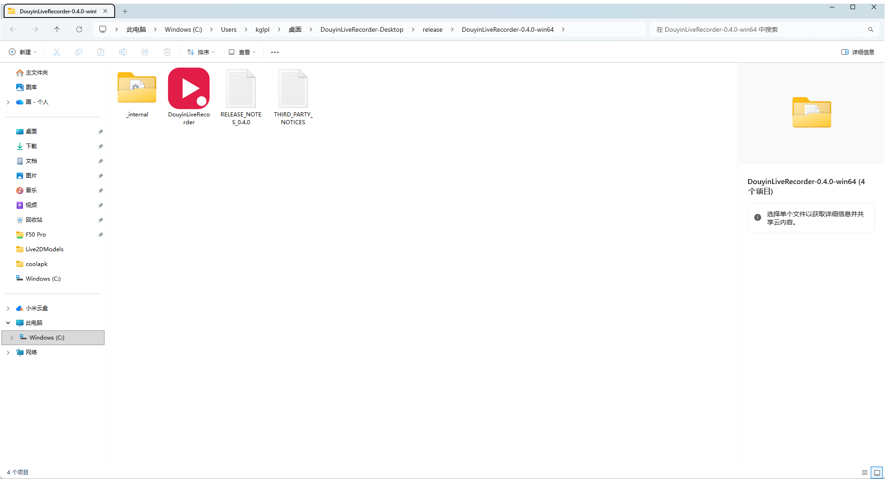
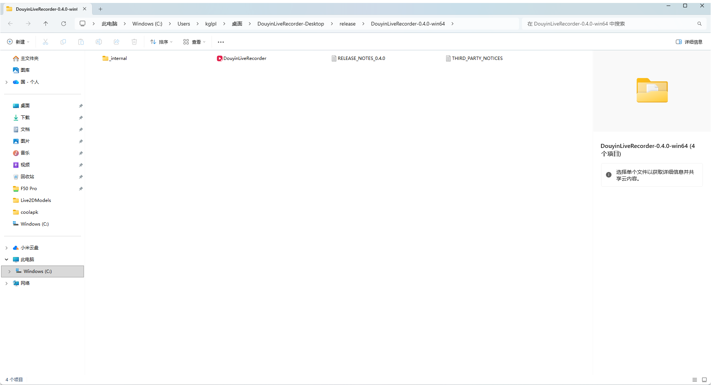
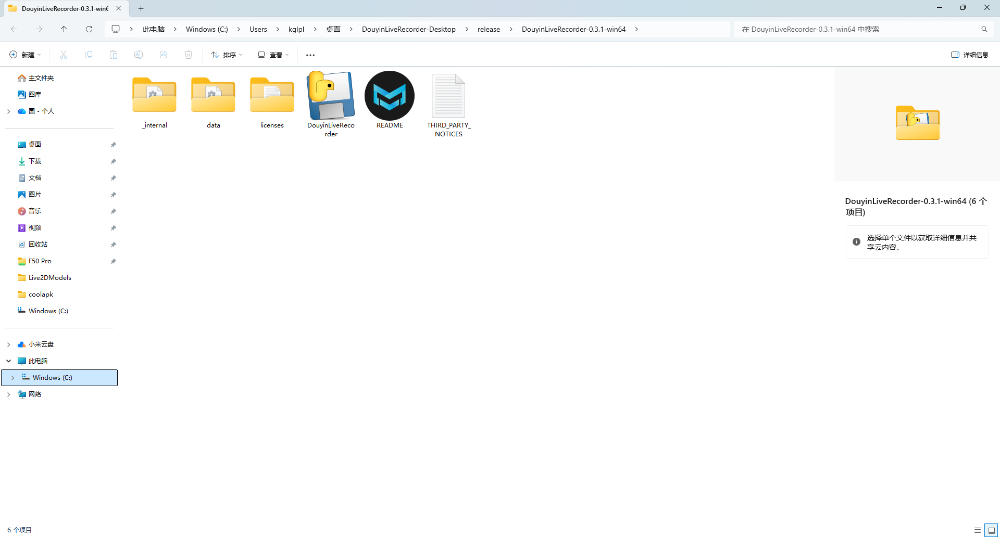
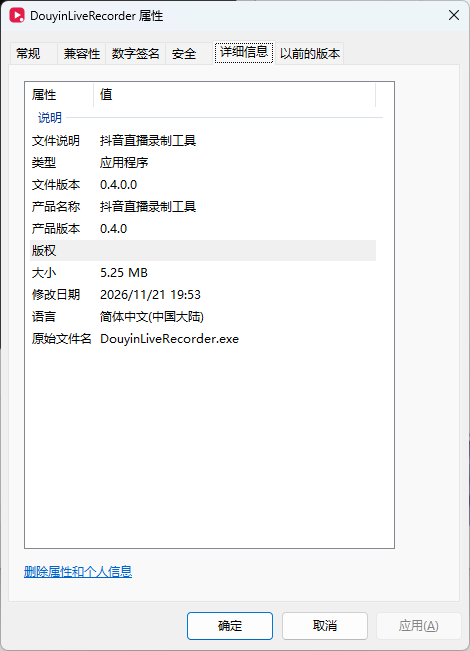
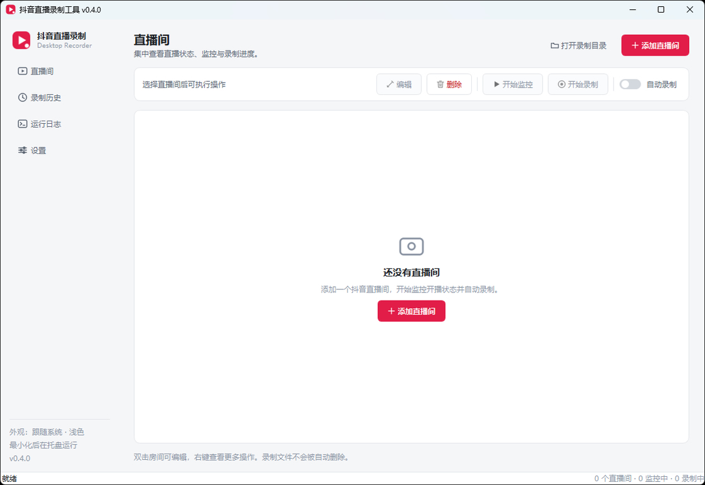
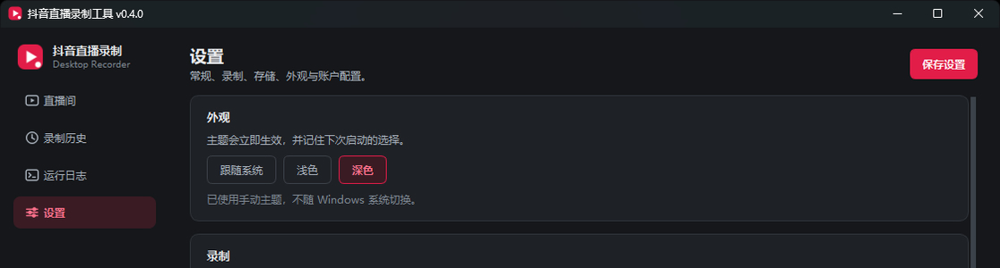
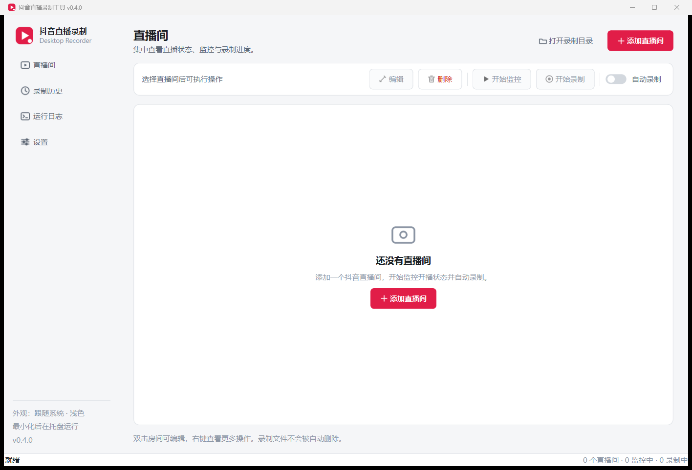

# v0.4.0 发布说明（GUI 现代化正式版）

- 发布日期：2026-11-21
- 技术基线：GUI Candidate 2（源码 `f168880` + 文档 `eb964e8`）
- 发布包：`release/DouyinLiveRecorder-0.4.0-win64.zip`（onedir 便携版，内置 FFmpeg）
- 性质：本地正式候选版本准备与封存；未上传 GitHub、未创建公开 Release

## 1. 本版变更

| 类别 | 内容 |
| --- | --- |
| GUI | 全新界面：侧边栏导航、直播间管理、录制历史、日志、设置、添加/编辑直播间 |
| 主题 | 深色 / 浅色 / 跟随系统，选择持久化到 `settings` 表 |
| 托盘 | 默认最小化到系统托盘；托盘菜单与双击恢复；托盘不可用或初始化异常时安全降级 |
| 图标 | 窗口、任务栏、Alt+Tab、系统托盘与 EXE 内嵌图标统一为同一品牌图形；`.ico` 含 16/20/24/32/40/48/64/96/128/256 px |
| 版本资源 | Windows 文件属性补齐：`FileVersion 0.4.0.0`、`ProductVersion 0.4.0`、`FileDescription 抖音直播录制工具` |
| 版本号 | 程序 `__version__`、`pyproject.toml`、窗口标题、关于信息、启动日志统一为 0.4.0 |

本版**未修改**：抖音解析核心、FFmpeg 录制状态机、数据库 Schema、已验收的 GUI 主要交互。

## 2. 图标来源

- 图形沿用 GUI 升级阶段既有的品牌绘制（玫红圆角方块 + 白色播放三角 + 右下白点），未重新设计。
- 来源代码：`src/dlrecorder/presentation/icons.py` 的 `_logo_pixmap()` / `app_icon()`。
- 构建期由 `build/make_icon.py` 以 4 倍超采样渲染并打包为 `build/assets/app.ico`，在 `build/pyinstaller.spec` 中通过 `icon=` 与 `version=` 嵌入 EXE。

## 3. 升级兼容性（从 0.3.1 / 候选版升级）

- 数据目录仍为 EXE 同级 `data\`，数据库 Schema 仍为 version 2（6 表），无迁移脚本。
- 配置键、录制目录、FFmpeg 路径解析、单实例互斥量名称均未变化，可直接沿用旧数据。
- 升级方式：退出旧版本 → 解压新包到新目录（或在旧目录替换程序文件）→ 启动。
  若在旧目录替换，请先备份 `data\`；本包不带 `data\`，首次启动自动创建。
- 回滚：保留旧目录或解压 0.3.1 / 候选版压缩包即可回退，数据结构向后兼容。

## 3.1 图标身份复核（2026-11-21 追加）

用户反馈资源管理器中 `DouyinLiveRecorder.exe` 仍显示黄蓝色旧图标，因此对最终 EXE 的 PE 图标资源与 Shell 实际返回值做了独立核验。

| 对象 | SHA-256 | PE 图标资源 | Shell 32px 取样色 | 结论 |
| --- | --- | --- | --- | --- |
| v0.4.0 发布 EXE | `D9DF7564…E8A5D` | 1 个组、10 个尺寸（16–256） | `#E11D48` | 品牌图标 |
| v0.4.0 EXE（改名复制到全新目录） | 同上 | 同上 | `#E11D48` | 品牌图标，排除路径级缓存 |
| 0.3.1 正式包 EXE | `C98A8F49…FAFE8` | 1 个组、7 个尺寸（8bpp/32bpp） | `#E9C63F`（黄） | PyInstaller 默认图标 |
| Candidate 1 / 2 EXE | `137D96F7…26596` / `BE8C1CD6…B4D1` | 同上 | `#E9C63F`（黄） | PyInstaller 默认图标 |

- v0.4.0 EXE 的每个尺寸与 `build/assets/app.ico` 逐字节一致（10/10 匹配，`build/verify_icon.py` 可复跑）。
- 黄蓝色图标只出现在未配置 `icon=` 的旧包（0.3.1 与两个 GUI 候选版）上，属于旧包既有状态，本版未覆盖旧包。
- 结论：v0.4.0 打包产物图标正确，黄蓝图标来自旧版本 EXE；本版**无需重新构建**，发布包与 EXE 哈希保持不变。

复核命令：

```
.venv\Scripts\python.exe build\verify_icon.py
```









## 4. 验证记录

- 完整自动化回归：`276 passed`，149.87 s（Windows / Python 3.12.16 / pytest 9.2.0）。
- 打包冒烟：真实 EXE 启动、标题显示 `v0.4.0`、最小化后主窗口隐藏且进程存活、关闭后退出码 0、无 `DouyinLiveRecorder` / `ffmpeg` 残留。
- 图标验收：资源管理器、任务栏、托盘菜单、浅色/深色主界面、125% 缩放均取自打包 EXE 实际运行截图（见 `docs/screenshots/release-0.4.0/`），未以 `.ico` 原图替代。
- 125% 缩放：以 `QT_SCALE_FACTOR=1.25` 运行打包 EXE，窗口 1416×964，界面与图标清晰、无错位，退出码 0。
- Alt+Tab：Windows 11 切换器为系统层浮层，脚本化按键未能稳定捕获，未提供截图；该位置与其他位置共用同一 EXE 内嵌图标资源，已由任务栏按钮与标题栏截图佐证。
- 数据隔离：本次冒烟在发布目录内生成的 `data/` 已清除，压缩包不含任何用户数据；首次启动自动创建空数据目录。








## 5. 已知问题

1. **P2-01（未修复）**：会话结束事件与分段结束事件字段混用，直播自然结束收尾时日志/状态栏可能出现「completed size=0」，与历史表（读数据库）不一致；数据库与录制文件不受影响。详见 [AUDIT_0.3.1_RECORDING_STATUS.md](AUDIT_0.3.1_RECORDING_STATUS.md) 第 11 节。修复需变更事件契约，属录制核心范围，另行授权。
2. **托盘双击**：Win11 将托盘图标收进「隐藏的图标」浮层时，系统浮层不向图标转发双击；此时请通过托盘菜单「显示主窗口」恢复。
3. **可靠性待查**：FFmpeg 偶发未知退出码、解析侧 SSL 连接异常、风控验证页中断；现有证据不足以定性，未做根因推断。
4. 未覆盖低配机、4K 多屏、数小时长录与休眠唤醒。

## 6. 自动化与打包测试

| 项目 | 命令 | 结果 |
| --- | --- | --- |
| 完整回归 | `.venv\Scripts\python.exe -m pytest -q` | `276 passed in 149.87s` |
| 版本资源 | `(Get-Item EXE).VersionInfo` | FileVersion 0.4.0.0 / ProductVersion 0.4.0 |
| 内嵌图标 | `ExtractAssociatedIcon` 导出 PNG | 品牌图标，非 Python 默认图标 |

## 6.1 发布包与校验

| 文件 | 大小 | SHA-256 |
| --- | --- | --- |
| `release/DouyinLiveRecorder-0.4.0-win64.zip` | 81,493,479 B | `FF0609D3B6D1FE380B8F6590085E5F7770FAAE469588A0692658F7CD676DE1D2` |
| `DouyinLiveRecorder.exe`（包内） | 5,511,871 B | `D9DF75647685541FFB72F346606F8BCE5CE228D350EF1488410A14BDCF9E8A5D` |

压缩包 172 个条目、含顶层目录、不含 `data/`；从 ZIP 解出的 EXE 哈希与目录内一致。

## 7. 许可与第三方声明

- 第三方组件与 FFmpeg 分发说明见包内 `THIRD_PARTY_NOTICES.txt`。
- 本仓库未声明额外的开源许可证文件；对外分发前请按 `THIRD_PARTY_NOTICES.txt` 与上游项目要求执行。
